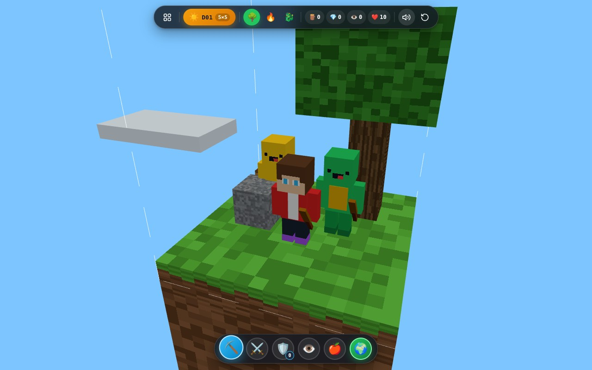

# 🌍🐉 JJ & Mikey: 100 Days in an Expanding World 3D (Minecraft)

👉 **Live Playable 3D Game (GitHub Pages)**: **[https://kunruiw1991.github.io/maizen-100days-expanding-world/](https://kunruiw1991.github.io/maizen-100days-expanding-world/)**



A zero-build 3D Three.js voxel game faithfully reproducing Maizen's **[`youtu.be/t5wy_OsuMvM`](https://youtu.be/t5wy_OsuMvM)** (*JJ and Mikey Survived 100 Days in an EXPANDING WORLD in Minecraft*), built with the streamlined wordless floating-pill interface from `critters-coloring-game`, authentic blocky 3D Maizen avatars (**JJ**, **Mikey**, and **Banana Buddy**), a live **Expanding World Border (`3×3` → `51×51`)**, all **3 Dimensions (Overworld, Nether, The End)**, and the **Day 100 Ender Dragon Boss Fight**.

## 🗺️ 8 Chronological 100-Day Eras (`youtu.be/t5wy_OsuMvM`)
1. **Day 1 (`00:20`)** — Floating `3×3` Sky Pillar surrounded by voxel clouds & dashed World Border, Oak Tree, Crafting Table & Furnace
2. **Day 11 (`07:10`)** — Expanded Plains Village cottages, Golden Wheat Farm & fenced Animal Ranch (Sheep & Cow)
3. **Day 40 (`19:40`)** — Diamond & Redstone Ore Mine + Copper Trial Chamber & Creeper
4. **Day 56 (`25:15`)** — Towering Cobblestone Sky Mob Grinder + Bookshelf Enchanting Room + Obsidian Nether Portal
5. **Day 61 (`28:20`)** — **The Nether Dimension**: Nether Brick Fortress Blazes (`🔥` Blaze Rods) + Warped Forest Endermen (`🟢` Ender Pearls → auto-craft Eyes of Ender!)
6. **Day 95 (`35:40`)** — Desert Sandstone Pyramid + Dark Oak Woodland Mansion with red carpet & Golden Apple treasure chests
7. **Day 99 (`38:15`)** — Stronghold Chamber & glowing green-eyed End Portal
8. **Day 100 (`39:30`)** — **The End Dimension**: 4 Towering Obsidian Pillars with spinning End Crystals + swooping 3D **Ender Dragon** boss fight!

## 🧪 Tests & Original-Video Claude/Codex Reproducibility Audit
```bash
node --test --experimental-test-coverage tests/unit.test.js
python3 tests/e2e_verify.py
./scripts/local_sub_qa.sh
```
Side-by-side comparison against the original YouTube frames: [`.qa/comparison_grid.png`](.qa/comparison_grid.png) & [`.qa/reference/`](.qa/reference/).
